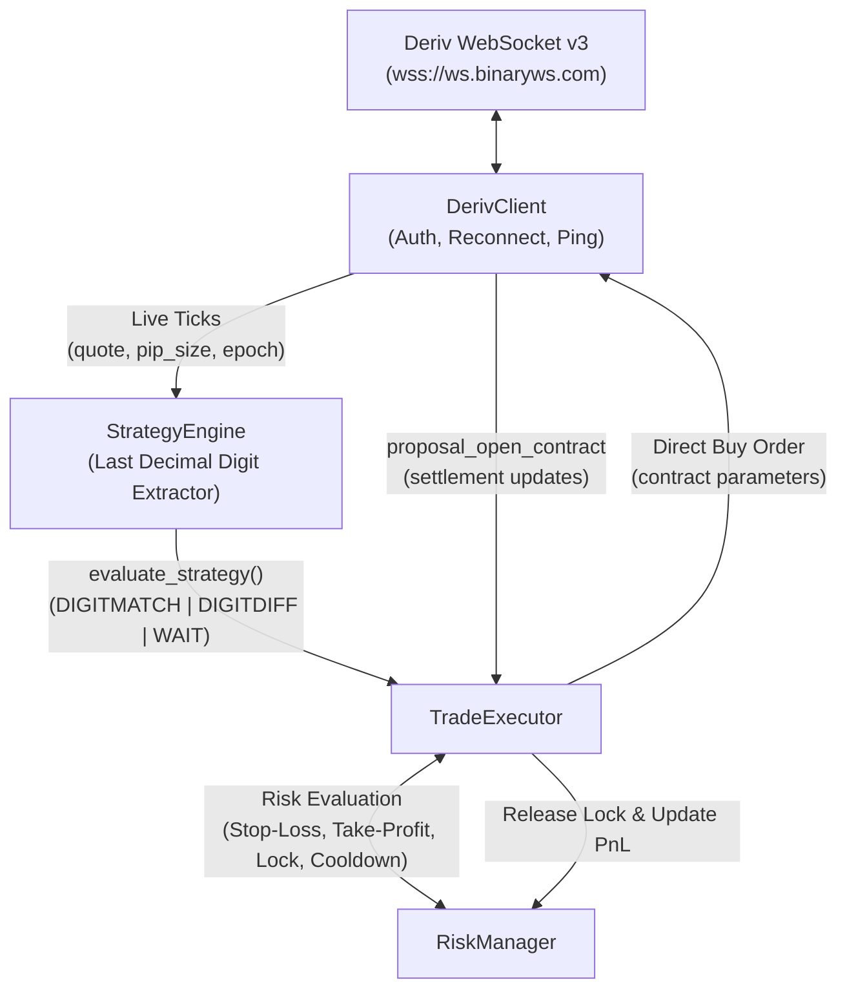

# Deriv Digit Trading Bot (Digit Match / Digit Differs)

An asynchronous automated algorithmic trading bot designed for high-frequency execution on **Deriv Synthetic Volatility Indices** (e.g., `R_100`, `1HZ100V`, `R_50`) using **Python 3.10+** and the **Deriv WebSocket API (v3)**.

---

## 🏛 Architecture Overview

The system is organized into modular components:

```
deriv/
├── config.py           # Loads environment variables, risk thresholds, and constants
├── deriv_client.py     # Asynchronous WebSocket transport, auth, ping keep-alive & auto-reconnect
├── strategy.py         # Strategy Engine: precision decimal digit extraction & pattern recognition
├── risk_manager.py     # Daily stop-loss, take-profit limits, trade locks & cooldown timers
├── trade_executor.py   # Deriv contract payload construction, order dispatch & lifecycle tracking
├── main.py             # Application orchestrator, dual console/file logging & signal handling
├── test_bot.py         # Unit and integration test suite
├── .env.example        # Configuration template
└── requirements.txt    # Python dependencies
```



---

## 🚀 Quick Start Guide

### 1. Prerequisites
- **Python 3.10+** (Python 3.11, 3.12, 3.13 supported)
- Active **Deriv** account ([deriv.com](https://deriv.com))

### 2. Installation
Clone repository and install dependencies:

```bash
git clone https://github.com/owuorbilgates/deriv.git
cd deriv
pip install -r requirements.txt
```

### 3. Obtain Your Deriv API Token
1. Log into your **Deriv Account**.
2. Navigate to **Account Settings** -> **API Token**.
3. Create a new token with at least **Read** and **Trade** scopes enabled.
4. Copy the token.

### 4. Configure `.env`
Copy `.env.example` to `.env`:

```bash
cp .env.example .env
```

Open `.env` in an editor and set your credentials:

```ini
# Deriv Credentials
DERIV_API_TOKEN=your_real_api_token_here
DERIV_APP_ID=1089

# Market & Strategy Settings
DERIV_SYMBOL=R_100
DERIV_CONTRACT_TYPE=DIGITDIFF
DERIV_STAKE_AMOUNT=1.00
DERIV_CURRENCY=USD
DERIV_DURATION=5
DERIV_DEFAULT_BARRIER=5

# Risk Management
DERIV_DAILY_STOP_LOSS=10.00
DERIV_DAILY_TAKE_PROFIT=20.00
DERIV_COOLDOWN_SECONDS=3.0

# Paper-Trading Simulation Mode (set true to test without real money)
DERIV_SIMULATION_MODE=false
```

---

## 🏃 Running the Bot

### Live Trading Mode:
```bash
python main.py
```

### Paper-Trading Simulation Mode (Offline Synthetic Ticks):
To test the strategy, order locks, and risk thresholds without live market risk:
```bash
python main.py --sim
```

### CLI Overrides:
You can override `.env` parameters dynamically at launch:
```bash
python main.py --symbol R_50 --stake 2.00 --type DIGITDIFF --duration 5 --stop-loss 15.00 --take-profit 30.00
```

---

## 🧠 Strategy Engine: Customizing Your Algorithm

The strategy engine resides in [strategy.py].

### Quantitative Digit Extraction Note
Standard floating-point conversion like `str(1245.50)[-1]` drops trailing zeroes (`"1245.5"` -> `'5'`), producing false digits. The bot uses exact fixed-width decimal formatting based on the market's `pip_size`:
```python
formatted_price = f"{quote:.{pip_size}f}"
last_digit = int(formatted_price[-1])
```

### Inserting Your Custom Rules
In [strategy.py], find the `evaluate_strategy` method:

```python
def evaluate_strategy(self, tick_history: Deque[TickData]) -> StrategySignal:
    # Digits list contains the most recent decimal digits [..., 7, 2, 9, 4]
    digits: List[int] = [t.last_digit for t in tick_history]
    
    # === USER STRATEGY LOGIC START ===
    # Example: Check if the last two digits are identical
    if len(digits) >= 2 and digits[-1] == digits[-2]:
        return StrategySignal(
            signal_type=SignalType.DIGITDIFF,
            predicted_barrier=digits[-1],
            confidence=0.92,
            reason=f"Repeated digit {digits[-1]} detected."
        )
    # === USER STRATEGY LOGIC END ===

    return StrategySignal(signal_type=SignalType.WAIT, predicted_barrier=0, confidence=0.0, reason="No pattern")
```

---

## 📡 Deriv API v3 Payload Structures

The bot communicates directly with the Deriv WebSocket API v3. Below are the core payloads:

### 1. Authentication
```json
{
  "authorize": "YOUR_API_TOKEN",
  "req_id": 1
}
```

### 2. Tick Stream Subscription
```json
{
  "ticks": "R_100",
  "subscribe": 1,
  "req_id": 2
}
```

### 3. Direct Contract Execution (Buy)
The direct buy payload eliminates round-trip latency:
```json
{
  "buy": 1,
  "price": 1.00,
  "parameters": {
    "amount": 1.00,
    "basis": "stake",
    "contract_type": "DIGITDIFF",
    "currency": "USD",
    "duration": 5,
    "duration_unit": "t",
    "symbol": "R_100",
    "barrier": "7"
  },
  "req_id": 3
}
```

### 4. Contract Lifecycle Subscription
```json
{
  "proposal_open_contract": 1,
  "contract_id": 12345678901,
  "subscribe": 1,
  "req_id": 4
}
```
When `is_sold == 1` or `status in ["won", "lost"]`, the settlement profit is recorded, lock released, and cooldown triggered.

---

## 🛡️ Risk Management & Error Handling

1. **Daily Stop-Loss & Take-Profit:** Halts trading as soon as net PnL crosses the defined boundaries.
2. **Concurrency Lock:** An `asyncio.Lock` ensures zero simultaneous open positions.
3. **Post-Trade Cooldown:** Enforces a configurable pause (e.g. 3.0s) between contract closing and next entry.
4. **Auto-Reconnection Protocol:** Catches `ConnectionClosed` / `InvalidStatus` / network dropouts, applies exponential backoff with jitter (`2s`, `4s`, `8s`, up to `30s`), reconnects, and automatically re-authenticates and resubscribes.
5. **Dual Logging:** Detailed logs are written to both standard output and `deriv_trading_bot.log` with millisecond timestamps.

---

## 🧪 Running Automated Tests

Run the full unit test suite:
```bash
python -m unittest deriv/test_bot.py
```
Test suite coverage includes:
- Precision decimal digit extraction (handling trailing zero edge cases)
- Consecutive repeat anomaly detection
- Frequency distribution triggers
- Concurrency trade lock and release
- Stop-loss and take-profit trip conditions
- Deriv contract payload structure validation
